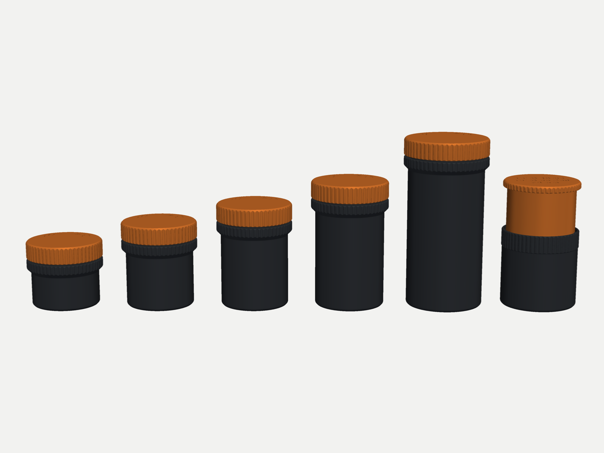
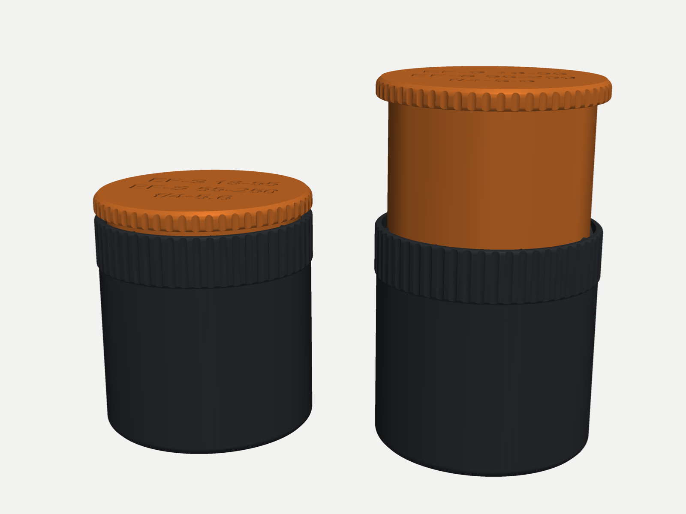
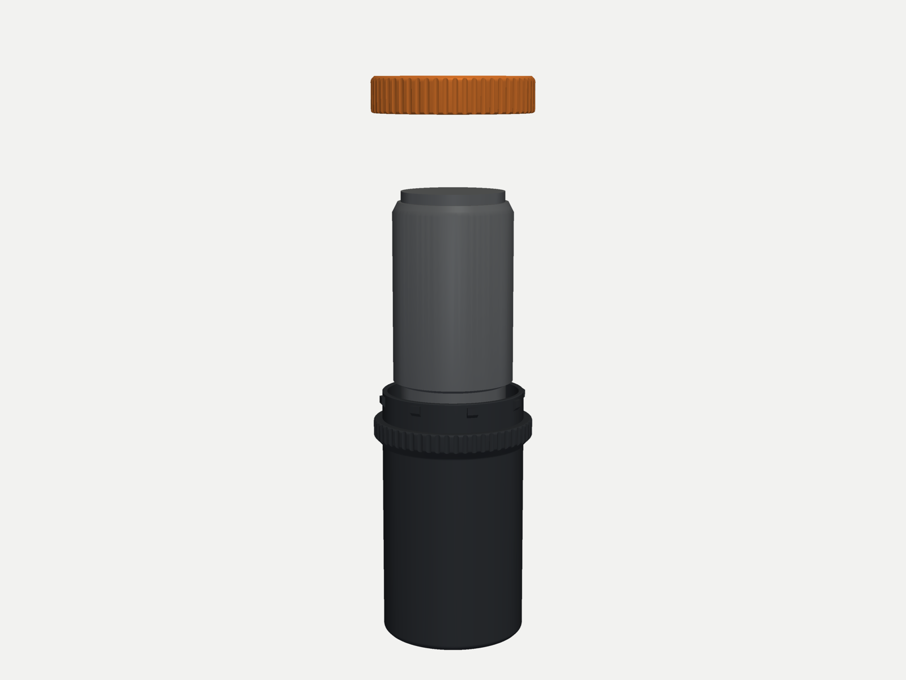
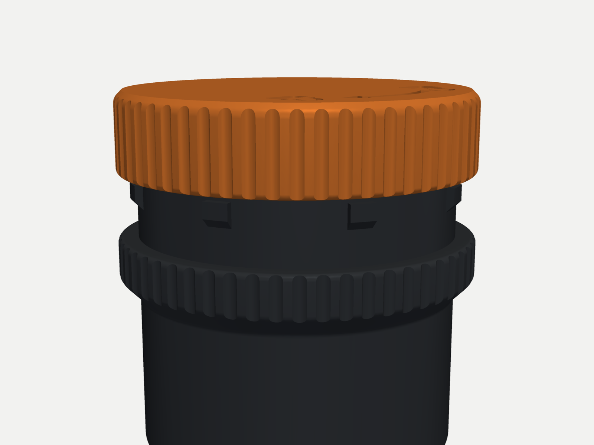
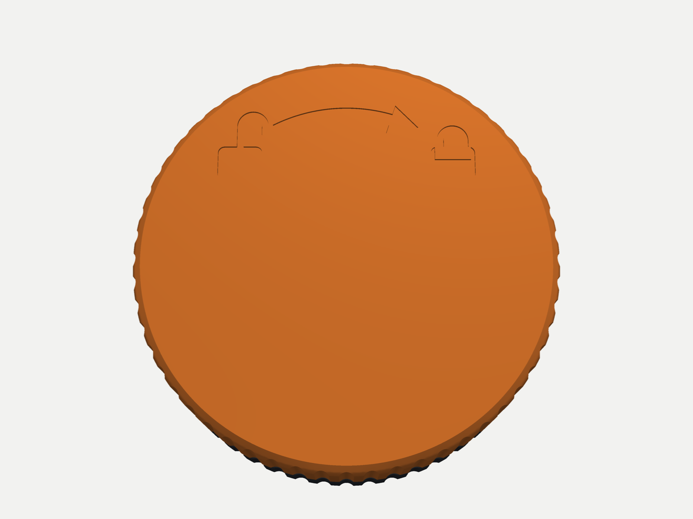
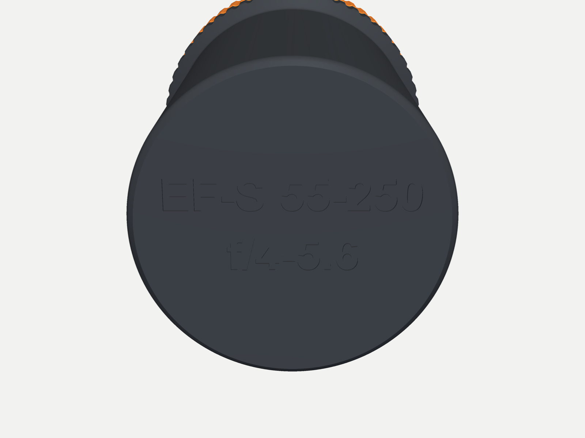

# 3D-printable lens cases

Protective cases for Canon lenses, made to be thrown in a backpack. Nothing sticks out,
the grip is recessed, and each case closes with a twist-lock (bayonet) or a screw lid.
Case 1 telescopes to fit several lenses.

Three styles: **bayonet** and **threaded** are printed in PETG and lined with foam; **tpu**
is threaded, printed in TPU, and fits the lens with a 1 mm gap and no foam. Case 1 also comes as
**tpu_bayonet**: the bayonet telescoping case in TPU with no foam: a 0.5 mm gap to the lens, 4.5 mm
walls and 5 mm ends, 1.5× bigger bayonet features and 0.1 mm looser gaps for the soft material
(97 × 92–144 mm, about 330 g).



## The cases

| Case | Holds | Bayonet / threaded (PETG, foam) | tpu (TPU, no foam) |
|---|---|---|---|
| 1 | Telescoping: EF-S 18-55, EF-S 18-55 + EF-EOS R adapter, EF-S 55-250, or any lens up to Ø71 mm and 91 / 115 mm long with its caps | 92 × 102–152 mm, 250 g / 313 g | 96 × 91–143 mm, 336 g |
| 2 | EF 50 mm f/1.8 STM | 91 × 79 mm, 148 g / 151 g | 90 × 68 mm, 166 g |
| 3 | RF 100-400 mm F5.6-8 IS USM | 102 × 203 mm, 332 g / 350 g | 100 × 192 mm, 358 g |
| 4 | EF-S 18-55 mm f/4-5.6 IS STM | 91 × 102 mm, 163 g / 165 g | 87 × 91 mm, 184 g |
| 5 | EF-S 55-250 mm f/4-5.6 IS STM | 93 × 152 mm, 245 g / 261 g | 91 × 143 mm, 255 g |
| 6 | EF-S 18-55 + EF-EOS R adapter | 91 × 124 mm, 177 g / 179 g | 92 × 113 mm, 225 g |

Sizes are Ø × length in mm (threaded is up to 2 mm wider than bayonet). Each lens is held with both caps on. In the foam styles, cases 2,
4 and 6 share the same lid.





## Printing

**Bambu Lab:** open `print/bambu/caseN_bayonet.3mf` (or `_threaded`, `_tpu`; `case1_tpu_bayonet`) in Bambu Studio,
slice and print. Each project has every part of one case on one plate, already oriented,
with the settings below. It is set up for the X1 Carbon / P1S with a 0.4 mm nozzle; on
another printer, choose yours when Bambu Studio asks.

**Other slicers:** the STLs in `print/stl/` are already in print orientation. STEP files
for editing are in `print/step/`.

| Setting | Value |
|---|---|
| Material | PETG (tpu style: TPU) |
| Layer height | 0.2 mm |
| Walls | 5 loops (2 mm, so the walls are solid; 3 with a 0.6 mm nozzle). Cases 1, 3 and 5: 7 loops (3 mm). tpu style: 9 loops (4 mm) |
| Top / bottom | 5 / 5 layers |
| Infill | 15 % gyroid |
| Supports, brim | none |

Print a lid first and test it on a body before printing the rest.

The bayonet and threaded styles need foam to line each case: 2.25 mm around the lens
(2–3 mm foam works), 8 mm under it and 5 mm over it. The tpu style needs no foam.

## Using them

**Bayonet:** put the lid on at any angle, push down and turn clockwise until it clicks.
Ramps inside the lid guide the pins in. To open, push, turn anticlockwise and lift.



**Case 1 (bayonet):** pull the top up, turn it into the position for your lens and let go.
The positions click in from shortest to longest. Ramps around the rim guide the top in at
any angle.

**Threaded:** screw the lid on (3/4 turn; it has two starts). Case 1 threaded has a lock ring; the marks on the thread
show each position (1 to 5 dashes, shortest first).

| | |
|---|---|
|  |  |
| Lock arrow on every lid (case 1: on the base) | Lens details on every base (case 1: on the top) |

## Making your own

Every dimension is in `params.py`. Edit it, then rebuild and check:

```sh
pip install -r requirements.txt
python build_all.py
python verify.py
```

For another lens, `python make_case.py --name ef35 --dia 77.9 --length 62.6 --rear-cap 12 --label "EF 35 f/2|IS USM"`
builds a fixed case from the lens's diameter and length.

If you use an AI coding assistant, point it at `AGENTS.md`. It has the design details, the
assumptions and how everything is checked.

## Known limitations

- Cap lengths are estimates (front 6 mm, EF rear 12 mm, RF rear 10 mm). Measure yours and
  change `FRONT_CAP`, `EF_REAR_CAP` and `RF_REAR_CAP` in `params.py` if they differ.
- The bayonet click and the clearances may need tuning for your printer
  (`DETENT_BUMP_H`, `SLIDE_CLEAR`, `THREAD_CLEAR`). The tpu styles are untested.
- Not waterproof.

## License

MIT (see `LICENSE`): the code, models and print files. Canon, EF, EF-S and RF are Canon trademarks; this project is not affiliated with Canon.
